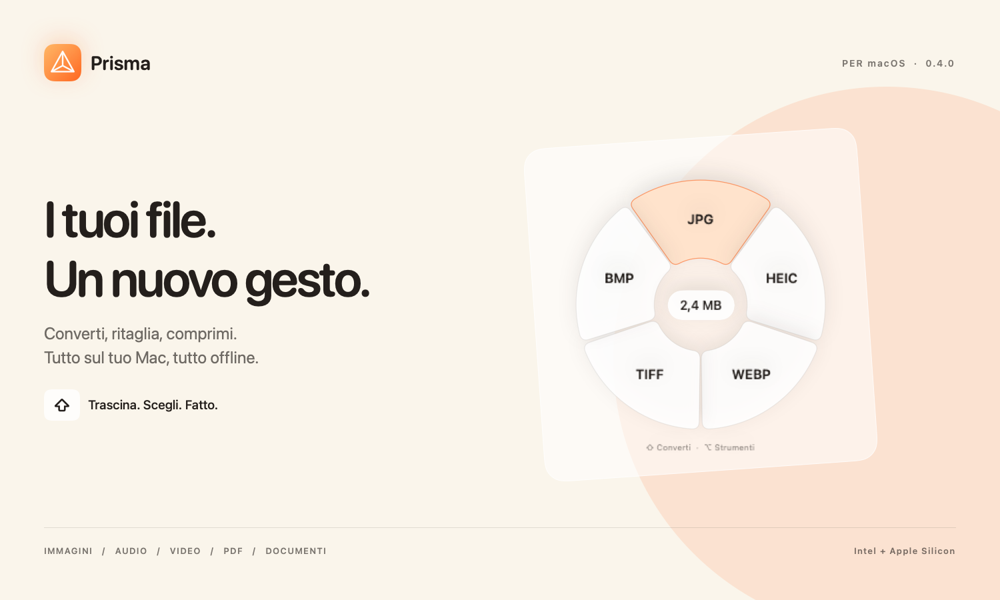
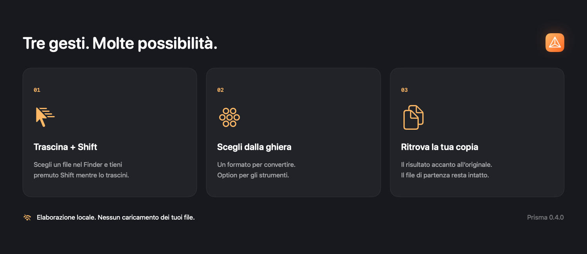

**Converti ed elabora i tuoi file, senza uscire dal Finder.**

Un’app nativa per macOS. Una ghiera intorno al puntatore. Tutto offline.

[**Release e download →**](https://github.com/GitAndreaHub/Prisma/releases)

*L’installer 0.4.0 è in preparazione per la distribuzione pubblica.*

## Un gesto che diventa abitudine

Trascina un file nel Finder e tieni premuto **Shift (⇧)**: Prisma apre una ghiera con i formati disponibili. Rilascia sul formato che desideri. Aggiungi **Option (⌥)** per accedere agli strumenti.

Prisma vive nella barra dei menu. Puoi anche usare **Scegli file…** o **Apri con → Prisma**. Ogni elaborazione crea una copia accanto all’originale, senza sovrascriverlo.

## Cosa puoi fare

| File | Conversioni e strumenti |
| :--- | :--- |
| **Immagini** | Converti tra formati comuni; comprimi, ridimensiona, ritaglia, regola, annota, oscura, aggiungi sfondi e leggi QR. |
| **Audio** | Converti, comprimi, normalizza e unisci. Taglia con forma d’onda e ascolto della selezione. |
| **Video** | Converti, comprimi, ritaglia, cambia velocità, dividi, unisci ed estrai audio o fotogrammi. |
| **PDF** | Unisci, dividi, ruota e riordina le pagine con miniature; estrai testo anche con OCR e oscura aree. |
| **Documenti** | Lavora con DOCX, DOC, RTF, TXT, HTML, ODT ed EPUB; esporta nei formati disponibili per il contenuto. |
| **Sottotitoli e archivi** | Converti SRT e VTT; crea ZIP, TAR, TAR.GZ e GZIP ed estrai gli archivi supportati da macOS. |

Le azioni cambiano in base al file selezionato. Le funzioni aggiuntive sono disponibili dal pannello **Scegli file…**.

## Installazione

Quando disponibile, scarica **Prisma-0.4.0-Universal.dmg** dalla sezione [Releases](https://github.com/GitAndreaHub/Prisma/releases).

1. Chiudi eventuali copie di Prisma già aperte.
2. Apri il DMG e trascina **Prisma** in **Applicazioni**.
3. Avvia Prisma dalla cartella Applicazioni.
4. Segui il tutorial interattivo del primo avvio. Puoi riaprirlo dal menu **Tutorial…**.

La versione 0.4.0 non è notarizzata da Apple. Se macOS blocca la prima apertura, dopo aver tentato l’avvio vai in **Impostazioni di Sistema → Privacy e sicurezza → Apri comunque**. Su Big Sur il percorso è **Preferenze di Sistema → Sicurezza e Privacy**.

## Pensata per il tuo Mac

- **Elaborazione locale:** i file vengono elaborati sul Mac, senza caricamento su servizi online.
- **Originali preservati:** i risultati sono nuove copie; i nomi già presenti non vengono sovrascritti.
- **Universal:** un unico installer per Intel e Apple Silicon, con requisito minimo macOS 11 Big Sur.
- **Interfaccia nativa:** tema chiaro/scuro, pannelli indipendenti e rispetto di Riduci movimento. Liquid Glass su macOS 26.

## Novità della 0.4.0

Una guida animata e interattiva accompagna il primo avvio: barra dei menu, trascinamento con Shift, formati e strumenti con Option, salvataggio della copia. Compare automaticamente una sola volta e rimane accessibile dal menu.

## Da sapere

Prova prima le elaborazioni su copie di test. I documenti Word con impaginazioni complesse possono differire dall’originale; PDF → DOCX estrae il testo e non ricostruisce il layout. La compressione PDF rasterizza le pagine e rimuove testo selezionabile, link e moduli. L’export SVG incorpora un’immagine raster. Gli editor fotografici su immagini animate elaborano il primo fotogramma e lo segnalano.

Il requisito macOS 11 è verificato nei binari. Intel è stato verificato anche tramite Rosetta; la prova su un Mac Intel con Big Sur resta da completare.

---

Questa repository presenta e distribuisce l’app compilata. **Il codice sorgente di Prisma non è pubblicato.** Le immagini sono mockup illustrativi; l’aspetto può variare con la versione e il tema di macOS. Le licenze dei componenti di terze parti sono incluse nell’app. I sorgenti dei motori sono gestiti nella repository separata [Prisma-Dependencies](https://github.com/GitAndreaHub/Prisma-Dependencies).
